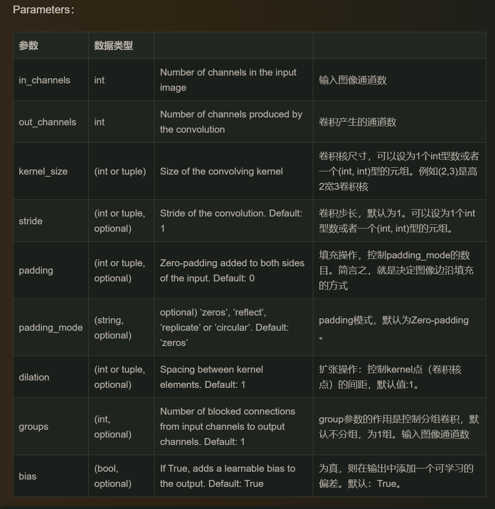
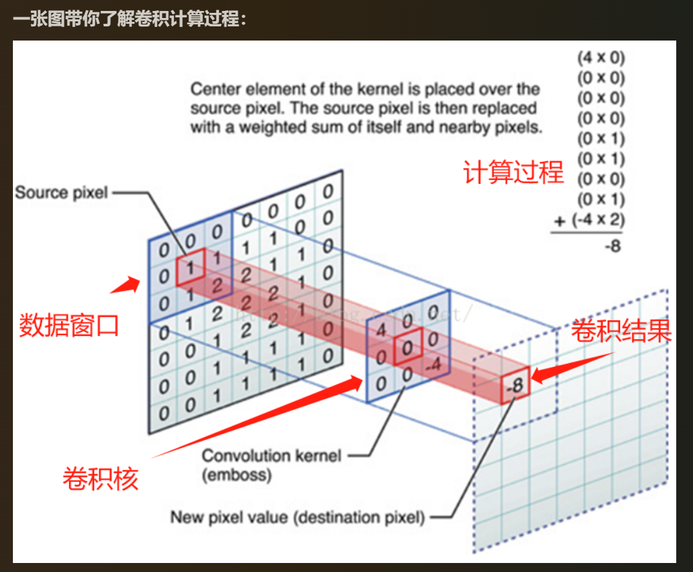

# MNIST 原理笔记

这份笔记记录 MNIST 阶段最核心的原理：张量形状、卷积、预处理和训练流程。完整排错见 [MNIST 踩坑与问答](mnist-troubleshooting.md)。

## 1. 一次前向传播的形状变化

```text
输入图片          [B, 1, 28, 28]
Conv1 1→16        [B, 16, 28, 28]
MaxPool 2×2       [B, 16, 14, 14]
Conv2 16→32       [B, 32, 14, 14]
MaxPool 2×2       [B, 32, 7, 7]
Conv3 32→64       [B, 64, 7, 7]
Flatten           [B, 3136]
Linear 3136→128   [B, 128]
Linear 128→10     [B, 10]
```

`B` 是 batch size。`Flatten` 默认保留第 0 维，只把后面的 `C×H×W` 展平。

卷积输出尺寸：

```text
H_out = (H_in + 2 × padding - kernel_size) / stride + 1
```

`3×3` 卷积配 `padding=1`、`stride=1` 时，宽高保持不变。

## 2. 卷积在算什么



卷积核在输入上滑动，每个位置做逐元素相乘再求和：



一个输出通道对应一个卷积核。`out_channels=16` 表示使用 16 个不同的卷积核，产生 16 张特征图。

## 3. `transform` 的含义

```python
transform = transforms.Compose([
    transforms.ToTensor(),
    transforms.Normalize(mean=[0.5], std=[0.5])
])
```

`Compose` 按列表顺序执行。每次从 Dataset 取一张图片时才会执行，不是创建数据集时一次性处理。

### `ToTensor()`

- 将 PIL 图片或 `uint8` 数组转成张量
- 形状从 `H×W×C` 变成 `C×H×W`
- 像素值从 `0~255` 缩放到 `0~1`

MNIST 单张图片：

```text
28×28，0~255 → [1, 28, 28]，0~1
```

### `Normalize(mean, std)`

```text
output = (input - mean) / std
```

代入 `mean=0.5, std=0.5`：

```text
output = (input - 0.5) / 0.5 = 2 × input - 1
```

数值变化：

| 原始像素 | ToTensor 后 | Normalize 后 |
| ---: | ---: | ---: |
| 0 | 0 | -1 |
| 128 | 约 0.502 | 约 0.004 |
| 255 | 1 | 1 |

`0.5` 不是 MNIST 数据集的真实均值，只是把 `[0,1]` 方便地映射到 `[-1,1]`。MNIST 只有一个灰度通道，所以参数列表中只有一个数。

## 4. Dataset 与 DataLoader

```python
train_data = torchvision.datasets.MNIST(
    path, train=True, transform=transform, download=True
)
```

- `train=True`：官方 60,000 张训练集
- `train=False`：官方 10,000 张测试集
- `download=True`：本地没有数据时下载，已有则直接使用
- `transform`：每次通过 `dataset[i]` 取样本时执行

```python
image, label = train_data[0]
```

返回的是元组，不是单张图片。`train_data[0][0]` 才是图片张量。

```python
train_loader = DataLoader(
    train_set, batch_size=64, shuffle=True
)
```

- 训练集打乱，减少批次顺序对训练的影响
- 验证集和测试集不打乱，方便复现与统计
- 一个 batch 的图片形状为 `[64, 1, 28, 28]`

## 5. 训练五步

```python
optimizer.zero_grad()                 # 1. 清空旧梯度
outputs = net(images)                 # 2. 前向传播
loss = criterion(outputs, labels)     # 3. 计算损失
loss.backward()                       # 4. 反向传播，计算梯度
optimizer.step()                      # 5. 更新参数
```

顺序不能乱：

- 不清梯度：新梯度会累加到旧梯度上
- 不反向传播：没有梯度，参数不会更新
- 不调用 `step()`：梯度算出来了，但模型没有变化

## 6. 损失与预测

```python
criterion = torch.nn.CrossEntropyLoss()
```

`CrossEntropyLoss` 内部包含 `LogSoftmax + NLLLoss`，所以模型输出 logits 即可，不要再加 Softmax。

预测类别：

```python
predicted = outputs.argmax(dim=1)
```

评估时同时使用：

```python
model.eval()
with torch.no_grad():
    ...
```

两者作用不同：

| 语句 | 作用 |
| --- | --- |
| `model.eval()` | 切换 Dropout/BatchNorm 的行为 |
| `torch.no_grad()` | 不记录梯度，节省显存和计算 |

## 7. 验证集的意义

```text
训练集 54,000：更新参数
验证集  6,000：每轮评估、挑选最佳模型
测试集 10,000：训练全部结束后只评估一次
```

如果每轮都用测试集挑模型，测试集就间接参与了模型选择，最终指标会偏乐观。

## 8. 保存最佳模型

```python
if val_acc > best_val_acc:
    best_val_acc = val_acc
    torch.save(net.state_dict(), best_path)
```

`state_dict` 只保存参数，不包含网络结构。加载前要先创建同样的模型：

```python
net = Net().to(device)
net.load_state_dict(torch.load(best_path, map_location=device))
```

MNIST 的验证损失在第 6 轮后开始上升，但最佳验证准确率出现在第 5 轮。保存最佳模型可以避免最终使用过拟合的最后一轮。
